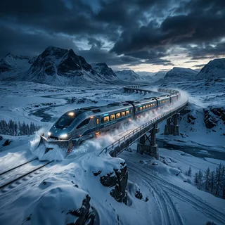

# Site Optimization Plan — arman1o1.github.io

Audit date: 2026-07-12. 26 HTML pages, hand-written static site, no build step.
All sizes below were measured on the actual repo files; conversion numbers come from test runs, not estimates.

## TL;DR

The site's structure, CSS, and semantics are in good shape. The dominant problem is **media weight**: 8.3 MB of PNGs and 12.3 MB of MP4s, with homepage thumbnails shipping 700–850 KB images into 160 px slots. Secondary problems: render-blocking `theme.js` + Google Fonts on every page, zero `width`/`height` attributes (CLS), and SEO metadata missing on 23 of 26 pages (no canonicals, no sitemap, no per-post OG tags). Phases 1–3 cut transferred bytes ~90% and fix discoverability in roughly a day of work, with no visual or URL changes.

| Metric | Now | After plan |
|---|---|---|
| images/ total | 8.3 MB | ~0.8 MB |
| Homepage image payload | ~2.0 MB | ~130 KB |
| Gemini Omni post initial load | ~12.5 MB (autoplay + 6 videos) | ~1.5 MB (1 video + posters) |
| Render-blocking requests per page | 4–7 (fonts CSS, styles, theme.js, prism ×3) | 2 (fonts CSS, styles) |
| Pages with canonical / full OG tags | 0 / 3 | 26 / 26 |
| sitemap.xml, robots.txt, RSS | none | all |

---

## Phase 1 — Media (biggest win, zero structural risk) ~2h — ✅ DONE 2026-07-12

> Executed: images/ 8.3 MB → 1.72 MB (WebP, 320w + 1000w variants, srcset + dimensions on all 50 img tags across 16 pages); videos 12.3 MB → 7.0 MB (CRF 26, faststart) with `preload="none"` + 12 KB posters on the 5 test videos; og-image.jpg 1200×630 @ 39 KB, metas updated; originals deleted, no dangling references. Site total: 21 MB → 9.1 MB.

### 1.1 Convert PNGs to resized WebP

Measured on this repo (quality 82, Lanczos resize):

| File | Now | Full-size WebP | Resized WebP |
|---|---|---|---|
| snowpiercer_2013.png (1024²) | 852 KB | 135 KB | **89 KB** (800w) |
| paprika_2006.png (1024²) | 1145 KB | 284 KB | **180 KB** (800w) |
| thumb_ai_ml.png (480²) | 358 KB | 38 KB | **21 KB** (320w) |

Sizing rule derived from `styles.css`:
- `.post-image-centered` renders at max 500 px → generate **1000w** WebP (2× DPR).
- `.thought-thumb` renders at 160 px (100% width ≤180 px tall on mobile) → generate **320w** and reuse the 1000w as the mobile/2x variant via `srcset`.

```bash
# from repo root; requires Pillow (or use cwebp)
python3 - <<'EOF'
from PIL import Image
import pathlib
for p in pathlib.Path('images').glob('*.png'):
    if p.stem == 'og-image': continue
    im = Image.open(p).convert('RGB')
    for w, suffix in [(1000, ''), (320, '-320')]:
        if im.width <= w and suffix: continue
        r = im.resize((min(w, im.width), int(im.height * min(w, im.width) / im.width)), Image.LANCZOS)
        r.save(p.with_name(f'{p.stem}{suffix}.webp'), 'WEBP', quality=82)
EOF
```

Then update the ~50 `` references (mechanical sed across `*.html`). Thumbnails on index/category/archives pages:

```html

```

Post hero images: plain `src` to the 1000w WebP + `width`/`height`. Also convert `dreams.jpg` (302 KB → ~90 KB) and re-export `bird.jpg` (already fine at 47 KB, optional). Delete the PNGs once references are updated — they otherwise stay in clones forever (git history note in Phase 5).

WebP support is universal since 2020; no `<picture>` fallback needed.

### 1.2 Videos: posters + preload (testing-gemini-omni.html)

Today: 6 MP4s totaling 12.3 MB on one page; the first has `autoplay` (forces full download); none set `preload`, so browsers fetch metadata for all six.

- Generate a poster per video — measured **12 KB** each as WebP:
  ```bash
  for v in assets/videos/*.mp4; do
    ffmpeg -i "$v" -vframes 1 -q:v 4 "${v%.mp4}-poster.jpg"
    cwebp -q 75 "${v%.mp4}-poster.jpg" -o "${v%.mp4}-poster.webp" && rm "${v%.mp4}-poster.jpg"
  done
  ```
- The 5 test videos: `<video controls preload="none" poster="...-poster.webp" ...>` — nothing downloads until click.
- The hero video: keep `autoplay muted loop playsinline` (it's the post's core demo) but re-encode. Measured: CRF 26 veryfast cut bird-4 from 2.87 MB → **1.47 MB** with no visible loss at 720p. Use `-preset slow -crf 26` for another ~10–15%:
  ```bash
  ffmpeg -i in.mp4 -c:v libx264 -crf 26 -preset slow -movflags +faststart -c:a copy out.mp4
  ```
- Re-encode all six regardless (12.3 MB → ~6 MB at rest; only ~1.5 MB transferred on load).
- Add `width="1280" height="720"` to every `<video>` (CLS).

### 1.3 og-image

`og-image.png` is 1024×1024, 403 KB. Scrapers want 1200×630; some (WhatsApp) skip images >300 KB. Export a 1200×630 **JPG** (~80–100 KB, q80 — JPG for scraper compatibility, not WebP).

---

## Phase 2 — Render path & CLS ~1.5h — ✅ DONE 2026-07-12

> Executed: theme.js split into inline head snippet (dark flip + `js` class) + deferred file on all 26 pages; theme-switch transition bug fixed via `html.theme-switching` class; fonts self-hosted (Inter 400/500/600/700 + Playfair 700, latin woff2, 120 KB total in assets/fonts/) with preloads, Google Fonts origins fully removed; Prism stripped from testing-gemini-omni (had no code blocks), `defer` added on the 5 code pages. Render-blocking external requests per page: 3–6 → 0 (only same-origin styles.css remains blocking).

### 2.1 Split theme.js (all 26 pages)

`theme.js` is loaded synchronously in `<head>` — render-blocking on every page. Only the dark-class flip must run early (FOUC); the rest (toggle, header, reveal) can defer:

```html
<script>(function(){var t=null;try{t=localStorage.getItem('theme')}catch(e){}
if(t!=='light')document.documentElement.classList.add('dark');
document.documentElement.classList.add('js')})()</script>
<script src="assets/theme.js" defer></script>
```

Remove the class-flip block from `theme.js`, keep `setup()`. The `js` class is used in 2.3.

While in there, fix a latent bug: `document.documentElement.style.transition='none'` on toggle only disables transitions on `<html>` itself — every descendant (`body`, cards, header) still animates its own `transition`, so theme switches repaint staggered. Replace with a class:

```js
document.documentElement.classList.add('theme-switching');
// ...toggle...
requestAnimationFrame(()=>requestAnimationFrame(()=>
  document.documentElement.classList.remove('theme-switching')));
```
```css
html.theme-switching *, html.theme-switching *::before, html.theme-switching *::after {
  transition: none !important;
}
```

### 2.2 Prism (6 AI/ML pages)

- `testing-gemini-omni.html` loads Prism CSS + 2 scripts but **has no code blocks** — remove all three tags.
- On the 5 real code pages: add `defer` to both scripts (`defer` preserves order, so core-before-autoloader still holds). The CSS stays but note `prism-tomorrow` is a dark theme rendered identically in light mode — acceptable, or switch to a `prefers-color-scheme`-aware pair later.

### 2.3 Fonts

Two blocking Google Fonts origins on every page. Options:

- **A (recommended): self-host.** Download Inter (400/500/600/700 latin subset — or the variable font, one ~45 KB woff2) and Playfair Display (600/700) via gwfh.mranftl.com or `glyphhanger`. Serve from `assets/fonts/`, declare with `font-display: swap`, and `<link rel="preload" as="font" type="font/woff2" crossorigin>` the two primary files. Removes 2 third-party origins + a blocking CSS fetch; fonts then also benefit from HTTP/2 on your own origin.
- **B (zero effort): keep as is.** `preconnect` is already correct; `display=swap` already set. This is the acceptable-loss option.

### 2.4 width/height everywhere

0 of 50 `` tags have dimensions → layout shift as images load. Covered by the Phase 1 rewrite of img tags; this item is just: don't skip it. (`img {max-width:100%; height:auto}` already in CSS keeps them responsive.)

---

## Phase 3 — SEO & discoverability ~2h — ✅ DONE 2026-07-12

> Executed: canonical + full OG/Twitter block on all 25 indexable pages (directory-style canonicals for index.html pages, `article` + `published_time` on all 18 posts); thin movie-review descriptions rewritten; scraper-safe `-og.jpg` copies generated for the 8 raster post heroes (visitors never load them); BlogPosting JSON-LD on every post, WebSite+Blog on home, pre-existing ProfilePage JSON-LD on About kept (old duplicate OG block removed, og:type=profile); sitemap.xml (25 URLs w/ lastmod), robots.txt, Atom feed.xml (18 entries) + autodiscovery links. All XML/JSON-LD validated. Still to do manually: submit sitemap in Google Search Console.

All pages currently: no canonical (0/26), OG tags on only index/about/archives, no twitter:card anywhere, no JSON-LD, no sitemap, no robots.txt, no feed.

### 3.1 Head block per page

Add to every page (values per page; URLs absolute):

```html
<link rel="canonical" href="https://arman1o1.github.io/posts/movies/snowpiercer-2013-movie-review.html">
<meta property="og:title" content="Snowpiercer (2013): Movie Review">
<meta property="og:description" content="...real 1–2 sentence description...">
<meta property="og:url" content="https://arman1o1.github.io/posts/movies/snowpiercer-2013-movie-review.html">
<meta property="og:image" content="https://arman1o1.github.io/images/snowpiercer_2013.webp">
<meta property="og:type" content="article">
<meta property="article:published_time" content="2026-06-21">
<meta name="twitter:card" content="summary_large_image">
<meta name="theme-color" content="#0c0d12">
```

Posts use their own hero image for `og:image` (already exists per post); index/category pages use the new 1200×630 og-image.jpg. Fix thin descriptions while at it (e.g. snowpiercer's is literally "Movie Review: Snowpiercer"). Index.html is missing `og:url` today — covered by this block.

### 3.2 JSON-LD

`BlogPosting` on each post (headline, datePublished, image, author, url), `Blog` + `WebSite` on index. ~10 lines per page, templated.

### 3.3 sitemap.xml + robots.txt + feed

- `sitemap.xml`: static list of the 26 URLs with `<lastmod>`. Submit to Google Search Console.
- `robots.txt`: `User-agent: *` / `Allow: /` / `Sitemap: https://arman1o1.github.io/sitemap.xml`.
- `feed.xml`: Atom feed, latest ~10 posts, `<link rel="alternate" type="application/atom+xml">` in heads. Hand-maintained until Phase 5 automates it.

**Non-goal:** do not restructure URLs to pretty directories (`/posts/movies/snowpiercer/`). The `.html` URLs are already indexed/shared; churning them costs more than the cosmetics are worth.

---

## Phase 4 — Accessibility & correctness ~1.5h — ✅ DONE 2026-07-12

> Executed: domain cards converted to stretched-link anchors (onclick removed ×5; middle-click/ctrl+click/keyboard now native, `:focus-within` styles added); `.reveal` hiding gated on `html.js` (content visible without JS); `prefers-reduced-motion` block added; first-visit theme now respects `prefers-color-scheme` (saved choice still wins — revert to dark-default by changing the inline snippet condition back to `t!=='light'` if preferred); 40 `.thought-title` divs → h3; duplicate `.domain-grid` merged; standard `line-clamp` added; 30 movie-image alts normalized (consistent per image, "AI-generated poster art for X").

1. **Domain cards (index.html):** `<li onclick="location.href=...">` breaks middle-click/ctrl+click (JS navigation, not a link) and duplicates the inner anchor. Use the pattern `.thought-card` already gets right — make the anchor the card, or stretched-link:
   ```css
   .domain-card { position: relative; }
   .domain-title::after { content:''; position:absolute; inset:0; }
   ```
   Then delete the `onclick` and `cursor:pointer`.
2. **No-JS content invisibility:** `.reveal { opacity: 0 }` hides cards permanently when JS fails/disabled. Gate it on the `js` class from 2.1: `html.js .reveal { opacity:0; transform:translateY(20px); ... }` and let `.reveal` default to visible.
3. **prefers-reduced-motion:** none today; shimmer/pulse/fadeInUp/reveal all animate unconditionally.
   ```css
   @media (prefers-reduced-motion: reduce) {
     *, *::before, *::after { animation: none !important; transition: none !important; }
     html { scroll-behavior: auto; }
     .reveal { opacity: 1; transform: none; }
   }
   ```
4. **prefers-color-scheme:** first visit hard-defaults to dark regardless of OS setting. In the inline snippet: `if (t ? t!=='light' : matchMedia('(prefers-color-scheme: dark)').matches) ...` — or keep dark-by-default deliberately; decide, but it's one line.
5. **Heading semantics:** `.thought-title` and card titles are `<div>`s — make them `<h3>` (index/category/archives) so the outline isn't h1→h2→nothing. Reset margins in CSS.
6. **CSS cleanup:** duplicate `.domain-grid` definition (lines ~612 and ~707 of styles.css) — merge. Add standard `line-clamp` alongside `-webkit-line-clamp` in `.thought-excerpt`.
7. **Alt-text pass:** several say "Poster of X movie" while the caption says "AI Image for X" — make alts describe the actual image.

---

## Phase 5 — Optional: kill the duplication ~3–4h, do only if the site keeps growing

Every page hand-copies head/header/nav/footer: adding one post means editing the post + index + category index + archives (4 files); changing the nav means 26 edits. Phase 3 makes this worse (more per-page head boilerplate).

- **Recommended: Eleventy.** One layout file, posts as Markdown with front-matter; index/category/archives/sitemap/feed all generated. Deploy via the standard 11ty GitHub Action. URLs can be preserved exactly (`permalink` front-matter), so no SEO churn. This also auto-solves feed/sitemap maintenance from 3.3.
- **Lighter alternative:** a ~100-line Python build script stamping `header.html`/`footer.html` partials into pages — no dependency, but you'll reinvent front-matter the moment you want auto-generated indexes.
- **Git hygiene (while at it):** the repo carries ~20 MB of media in history; after Phase 1 replaces PNGs/MP4s, history still holds originals. Fine for GitHub Pages; only bother with `git filter-repo` if clone size starts to annoy you.

Skip this phase entirely if the posting rate stays at a few per month and hand-editing doesn't bother you — the site works.

---

## Verification checklist

- [ ] Lighthouse (Chrome DevTools, mobile preset) on `/`, one movie review, and `testing-gemini-omni.html` — before and after. Expect Performance 90+, CLS ≈ 0, LCP < 2.5 s on Fast 3G for `/`.
- [ ] `du -sh images/ assets/videos/` — targets: ≤1 MB, ≤7 MB.
- [ ] DevTools Network tab on `testing-gemini-omni.html`: initial transfer ≤2 MB, nothing loads for the 5 paused videos.
- [ ] Toggle theme in both directions — no transition flash, no console errors; disable JS — all content visible, cards still navigate.
- [ ] Keyboard-only pass on index: every card reachable and activatable; middle-click opens new tab.
- [ ] validator.w3.org on 2–3 pages; a social-card preview tool (opengraph.xyz) on a post URL.
- [ ] Search Console: submit sitemap.xml, confirm indexing of a few post URLs.

## Suggested order & effort

| Phase | Effort | Payoff |
|---|---|---|
| 1 Media | ~2h | ~90% of the win |
| 2 Render path | ~1.5h | faster first paint, no CLS |
| 3 SEO | ~2h | discoverability, proper link previews |
| 4 A11y/correctness | ~1.5h | real bug fixes (middle-click, no-JS, motion) |
| 5 Templating | ~3–4h | maintainability only — optional |

Phases 1–4 are independent and each shippable as its own commit/PR.
